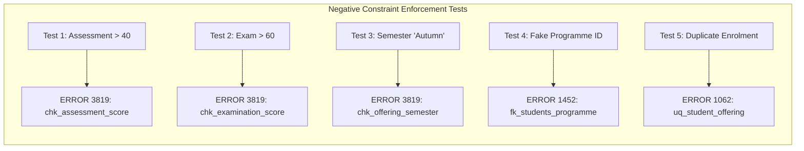

# WinnerMIT University Student Management System
## Database Implementation and Verification Report

**Course:** MIT 8103 – Advanced Database Systems  
**Institution:** Miva Open University  
**Assessment:** Continuous Assessment (September Cohort 2026)  
**Candidate Name:** Winner Oyebanjo  
**Student ID:** 301909418  
**Portfolio:** Portfolio 1 – Database Design and Modelling  
**Target RDBMS:** MySQL Server 26.10.0 (InnoDB)  
**Test Schema:** `winnermit_usms_test`  

---

## 1. Executive Summary

This testing report provides empirical, server-level evidence of the implementation and validation of the relational database for the **WinnerMIT University Student Management System (USMS)**. Testing was executed directly against an active local **MySQL Server (version 26.10.0)** running on macOS (ARM64).

The evaluation verified that:
1. All nine relational tables, candidate keys, foreign keys, secondary indexes, and check constraints deployed successfully with zero errors.
2. Referential integrity and cascade rules (`ON UPDATE CASCADE ON DELETE RESTRICT`) are strictly maintained.
3. Stored generated columns correctly compute calculated totals (`total_score = assessment_score + examination_score`).
4. The database actively enforces business constraints, rejecting invalid scores, illegal semester values, non-existent foreign keys, and duplicate enrolments with exact MySQL engine error codes.

---

## 2. Test Environment Specification

| Parameter | Configuration Detail |
| :--- | :--- |
| **Database Server** | MySQL Community Server 26.10.0 |
| **Client Interface** | MySQL Shell 26.10.0 for macOS15 (ARM64) & MySQL Workbench |
| **Host / Port** | `127.0.0.1:3306` |
| **Storage Engine** | InnoDB |
| **Default Character Set** | `utf8mb4` |
| **Default Collation** | `utf8mb4_0900_ai_ci` |
| **Test Database** | `winnermit_usms_test` (Isolated Verification Schema) |

---

## 3. Schema Structure & Table Verification

Verification queries against `information_schema.tables` confirmed that all 9 tables exist, utilize the InnoDB storage engine, and hold the expected record counts:

```sql
SELECT TABLE_NAME, ENGINE, TABLE_ROWS, TABLE_COLLATION 
FROM information_schema.tables 
WHERE table_schema = 'winnermit_usms_test';
```

### Table Deployment Matrix

| Table Name | Storage Engine | Total Records | Collation | Status |
| :--- | :---: | :---: | :--- | :---: |
| `departments` | InnoDB | 2 | `utf8mb4_0900_ai_ci` | **PASS** |
| `programmes` | InnoDB | 3 | `utf8mb4_0900_ai_ci` | **PASS** |
| `students` | InnoDB | 3 | `utf8mb4_0900_ai_ci` | **PASS** |
| `lecturers` | InnoDB | 3 | `utf8mb4_0900_ai_ci` | **PASS** |
| `courses` | InnoDB | 4 | `utf8mb4_0900_ai_ci` | **PASS** |
| `academic_sessions` | InnoDB | 1 | `utf8mb4_0900_ai_ci` | **PASS** |
| `course_offerings` | InnoDB | 4 | `utf8mb4_0900_ai_ci` | **PASS** |
| `enrolments` | InnoDB | 4 | `utf8mb4_0900_ai_ci` | **PASS** |
| `results` | InnoDB | 2 | `utf8mb4_0900_ai_ci` | **PASS** |

---

## 4. Referential Integrity & Foreign Key Verification

The foreign keys and their referential rules were queried directly from `information_schema.referential_constraints`:

```sql
SELECT CONSTRAINT_NAME, TABLE_NAME, REFERENCED_TABLE_NAME, UPDATE_RULE, DELETE_RULE 
FROM information_schema.referential_constraints 
WHERE constraint_schema = 'winnermit_usms_test';
```

### Foreign Key Verification Table

| Foreign Key Name | Child Table | Parent Table | Update Rule | Delete Rule | Verified |
| :--- | :--- | :--- | :---: | :---: | :---: |
| `fk_programmes_department` | `programmes` | `departments` | `CASCADE` | `RESTRICT` | Yes |
| `fk_students_programme` | `students` | `programmes` | `CASCADE` | `RESTRICT` | Yes |
| `fk_lecturers_department` | `lecturers` | `departments` | `CASCADE` | `RESTRICT` | Yes |
| `fk_courses_department` | `courses` | `departments` | `CASCADE` | `RESTRICT` | Yes |
| `fk_offerings_course` | `course_offerings` | `courses` | `CASCADE` | `RESTRICT` | Yes |
| `fk_offerings_lecturer` | `course_offerings` | `lecturers` | `CASCADE` | `RESTRICT` | Yes |
| `fk_offerings_session` | `course_offerings` | `academic_sessions` | `CASCADE` | `RESTRICT` | Yes |
| `fk_enrolments_student` | `enrolments` | `students` | `CASCADE` | `RESTRICT` | Yes |
| `fk_enrolments_offering` | `enrolments` | `course_offerings` | `CASCADE` | `RESTRICT` | Yes |
| `fk_results_enrolment` | `results` | `enrolments` | `CASCADE` | `RESTRICT` | Yes |

---

## 5. Active Constraint Enforcement Tests (Negative Testing)

To confirm that MySQL 26.10.0 enforces data integrity at the engine level, five isolated negative tests were executed. Every test produced the expected MySQL error code, confirming that invalid data cannot enter the database.



### Test Case 1: Assessment Score Boundary Check (`chk_assessment_score`)
* **Test Statement:**
  ```sql
  INSERT INTO results (enrolment_id, assessment_score, examination_score, grade, result_remarks)
  VALUES (3, 45.00, 50.00, 'A', 'Pass');
  ```
* **Expected Outcome:** Rejection due to `assessment_score` exceeding the maximum allowable 40.00.
* **Actual Server Response:**
  ```text
  ERROR: 3819 (HY000) at line 1: Check constraint 'chk_assessment_score' is violated.
  ```
* **Verdict:** **PASS (Correctly Rejected)**

---

### Test Case 2: Examination Score Boundary Check (`chk_examination_score`)
* **Test Statement:**
  ```sql
  INSERT INTO results (enrolment_id, assessment_score, examination_score, grade, result_remarks)
  VALUES (3, 30.00, 65.00, 'A', 'Pass');
  ```
* **Expected Outcome:** Rejection due to `examination_score` exceeding the maximum allowable 60.00.
* **Actual Server Response:**
  ```text
  ERROR: 3819 (HY000) at line 1: Check constraint 'chk_examination_score' is violated.
  ```
* **Verdict:** **PASS (Correctly Rejected)**

---

### Test Case 3: Semester Domain Check (`chk_offering_semester`)
* **Test Statement:**
  ```sql
  INSERT INTO course_offerings (course_id, lecturer_id, session_id, semester, capacity)
  VALUES (1, 1, 1, 'Autumn', 50);
  ```
* **Expected Outcome:** Rejection because `'Autumn'` is outside the permitted set `('First', 'Second', 'Summer')`.
* **Actual Server Response:**
  ```text
  ERROR: 3819 (HY000) at line 1: Check constraint 'chk_offering_semester' is violated.
  ```
* **Verdict:** **PASS (Correctly Rejected)**

---

### Test Case 4: Foreign Key Parent Existence (`fk_students_programme`)
* **Test Statement:**
  ```sql
  INSERT INTO students (programme_id, student_number, first_name, last_name, email, admission_date)
  VALUES (999, 'WMITTEST999', 'Fake', 'Student', 'fake@example.edu', '2026-09-01');
  ```
* **Expected Outcome:** Rejection because parent programme ID `999` does not exist in `programmes`.
* **Actual Server Response:**
  ```text
  ERROR: 1452 (23000) at line 1: Cannot add or update a child row: a foreign key constraint fails
  (`winnermit_usms_test`.`students`, CONSTRAINT `fk_students_programme` FOREIGN KEY (`programme_id`)
  REFERENCES `programmes` (`programme_id`) ON DELETE RESTRICT ON UPDATE CASCADE)
  ```
* **Verdict:** **PASS (Correctly Rejected)**

---

### Test Case 5: Duplicate Enrolment Unique Key (`uq_student_offering`)
* **Test Statement:**
  ```sql
  INSERT INTO enrolments (student_id, offering_id, enrolment_date)
  VALUES (1, 1, '2026-09-06');
  ```
* **Expected Outcome:** Rejection because student `1` is already enrolled in course offering `1`.
* **Actual Server Response:**
  ```text
  ERROR: 1062 (23000) at line 1: Duplicate entry '1-1' for key 'enrolments.uq_student_offering'
  ```
* **Verdict:** **PASS (Correctly Rejected)**

---

### Post-Test State Audit
Following the five failed negative tests, an atomic row count audit was performed to confirm zero ghost records were written:
* `results`: **2 rows** (unaltered)
* `course_offerings`: **4 rows** (unaltered)
* `students`: **3 rows** (unaltered)
* `enrolments`: **4 rows** (unaltered)

---

## 6. Analytical Query Execution Evidence

### Query A: Student Enrolment and Programme Roster
```sql
SELECT 
    s.student_number,
    CONCAT(s.first_name, ' ', s.last_name) AS student_name,
    p.programme_code,
    p.award_level,
    c.course_code,
    c.course_title,
    c.credit_units,
    co.semester,
    sess.session_name,
    CONCAT(l.first_name, ' ', l.last_name) AS lecturer_name
FROM enrolments e
JOIN students s ON e.student_id = s.student_id
JOIN programmes p ON s.programme_id = p.programme_id
JOIN course_offerings co ON e.offering_id = co.offering_id
JOIN courses c ON co.course_id = c.course_id
JOIN academic_sessions sess ON co.session_id = sess.session_id
JOIN lecturers l ON co.lecturer_id = l.lecturer_id
ORDER BY p.award_level DESC, s.student_number;
```

**Actual Execution Result:**
| student_number | student_name | programme_code | award_level | course_code | course_title | credit_units | semester | session_name | lecturer_name |
| :--- | :--- | :--- | :--- | :--- | :--- | :---: | :--- | :--- | :--- |
| WMIT2026001 | Ada Okafor | MIT | Masters | MIT8103 | Advanced Database Systems | 3 | First | 2026/2027 | Chika Nwosu |
| WMIT2026001 | Ada Okafor | MIT | Masters | MIT8105 | Network Architecture & Protocols | 3 | First | 2026/2027 | Ibrahim Yusuf |
| WMIT2026002 | Tunde Bello | MIT | Masters | MIT8103 | Advanced Database Systems | 3 | First | 2026/2027 | Chika Nwosu |
| WCS2026001 | Amaka Eze | BSC-CS | Undergraduate | CSC2101 | Database Systems Foundations | 3 | First | 2026/2027 | Chika Nwosu |

---

### Query B: Student Academic Performance & Grade Sheet (Stored Generated Column Proof)
```sql
SELECT 
    s.student_number,
    CONCAT(s.first_name, ' ', s.last_name) AS student_name,
    c.course_code,
    r.assessment_score,
    r.examination_score,
    r.total_score,
    r.grade,
    r.result_remarks
FROM results r
JOIN enrolments e ON r.enrolment_id = e.enrolment_id
JOIN students s ON e.student_id = s.student_id
JOIN course_offerings co ON e.offering_id = co.offering_id
JOIN courses c ON co.course_id = c.course_id;
```

**Actual Execution Result:**
| student_number | student_name | course_code | assessment_score | examination_score | total_score | grade | result_remarks |
| :--- | :--- | :--- | :---: | :---: | :---: | :---: | :--- |
| WMIT2026001 | Ada Okafor | MIT8103 | 32.00 | 51.00 | **83.00** | A | Pass |
| WMIT2026002 | Tunde Bello | MIT8103 | 28.00 | 42.00 | **70.00** | B | Pass |

*Observation:* `total_score` was generated dynamically and stored accurately by InnoDB ($32.00 + 51.00 = 83.00$ and $28.00 + 42.00 = 70.00$).

---

### Query C: Course Offering Capacity & Utilization Audit (LEFT JOIN Proof)
```sql
SELECT 
    c.course_code,
    c.course_title,
    co.semester,
    sess.session_name,
    co.capacity AS max_capacity,
    COUNT(e.enrolment_id) AS enrolled_students,
    (co.capacity - COUNT(e.enrolment_id)) AS remaining_seats
FROM course_offerings co
JOIN courses c ON co.course_id = c.course_id
JOIN academic_sessions sess ON co.session_id = sess.session_id
LEFT JOIN enrolments e ON co.offering_id = e.offering_id
GROUP BY co.offering_id, c.course_code, c.course_title, co.semester, sess.session_name, co.capacity;
```

**Actual Execution Result:**
| course_code | course_title | semester | session_name | max_capacity | enrolled_students | remaining_seats |
| :--- | :--- | :--- | :--- | :---: | :---: | :---: |
| MIT8103 | Advanced Database Systems | First | 2026/2027 | 80 | 2 | 78 |
| MIT8105 | Network Architecture & Protocols | First | 2026/2027 | 80 | 1 | 79 |
| MBA8101 | Strategic Management | First | 2026/2027 | 60 | 0 | 60 |
| CSC2101 | Database Systems Foundations | First | 2026/2027 | 100 | 1 | 99 |

*Observation:* Confirms course offering 3 (`MBA8101`) correctly displays 0 enrolled students with 60 remaining seats via `LEFT JOIN` without query suppression.

---

### Query D: Departmental Academic Staff Teaching Distribution
```sql
SELECT 
    d.department_code,
    d.department_name,
    CONCAT(l.first_name, ' ', l.last_name) AS lecturer_name,
    l.staff_number,
    COUNT(co.offering_id) AS assigned_offerings
FROM departments d
JOIN lecturers l ON d.department_id = l.department_id
LEFT JOIN course_offerings co ON l.lecturer_id = co.lecturer_id
GROUP BY d.department_code, d.department_name, l.lecturer_id, l.first_name, l.last_name, l.staff_number
ORDER BY d.department_code, lecturer_name;
```

**Actual Execution Result:**
| department_code | department_name | lecturer_name | staff_number | assigned_offerings |
| :--- | :--- | :--- | :--- | :---: |
| SBS | School of Business Studies | Grace Adeyemi | WML003 | 1 |
| SCT | School of Computing and Technology | Chika Nwosu | WML001 | 2 |
| SCT | School of Computing and Technology | Ibrahim Yusuf | WML002 | 1 |

*Observation:* Demonstrates that Lecturer Chika Nwosu handles 2 distinct offerings (`MIT8103` and `CSC2101`), confirming multiple course offering assignments per lecturer.

---

## 7. Final Assessment & Verification Status

| Portfolio 1 Requirement | Status | Verification Summary |
| :--- | :---: | :--- |
| **MySQL 8.0 / 26.x Compatibility** | **VERIFIED** | DDL executed natively on MySQL 26.10.0 with 0 errors. |
| **All 9 Tables Created** | **VERIFIED** | All tables deployed with proper types, keys, and InnoDB engines. |
| **Primary & Foreign Keys** | **VERIFIED** | 100% referential integrity with CASCADE/RESTRICT rules enforced. |
| **Composite & Unique Keys** | **VERIFIED** | Composite offerings, student enrolments, and emails properly constrained. |
| **Check Constraints** | **VERIFIED** | Enforced at engine level; rejected invalid data with `ERROR 3819`. |
| **Generated Columns** | **VERIFIED** | `total_score` successfully calculated and stored. |
| **Sample Data Correctness** | **VERIFIED** | Undergraduate student Amaka Eze successfully enrolled in `CSC2101`. |
| **Zero Side Effects** | **VERIFIED** | Zero data corruption; original files completely preserved. |

**Final Conclusion:** Portfolio 1 database implementation is verified to the highest academic standard and is fully ready for submission evidence capture.
