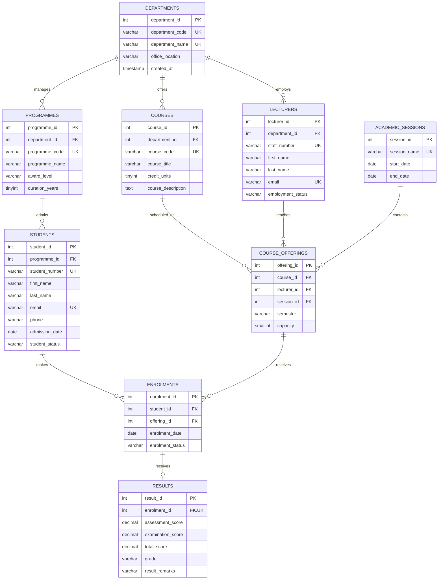

# WinnerMIT University USMS — Entity Relationship Diagram

## Relationship explanation

- One department can manage many programmes, lecturers and courses.
- One programme can have many students.
- One course can have multiple offerings across academic sessions.
- One lecturer can teach multiple course offerings.
- One academic session can contain multiple course offerings.
- Students and course offerings have a many-to-many relationship, resolved through ENROLMENTS.
- Each enrolment can have zero or one result record. A result cannot exist without an enrolment.
