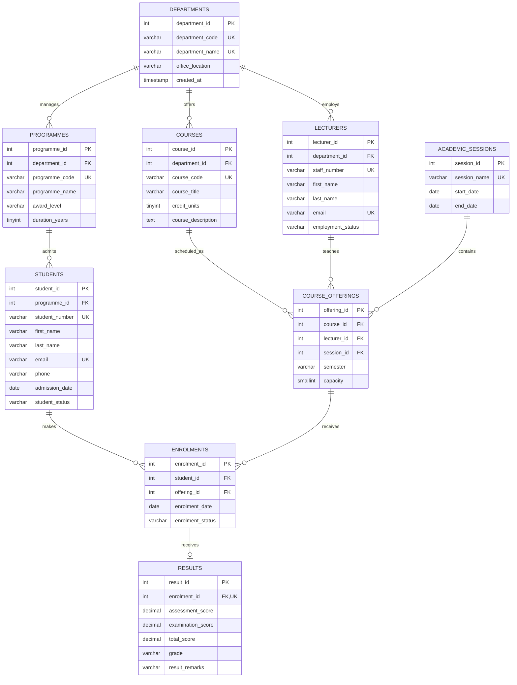

# Miva Open University — School of Computing and Artificial Intelligence
# MIT 8103: Advanced Database Systems
## Continuous Assessment — Portfolio 1: Database Design and Modelling
### Case Study: WinnerMIT University Student Management System (USMS)

---

**Student Name:** Winner Oyebanjo  
**Student ID:** 301909418  
**Programme:** Master of Information Technology (MIT)  
**Cohort:** September Cohort 2026  
**Target RDBMS:** MySQL Server 26.10.0 (InnoDB)  
**Verified Test Database:** `winnermit_usms_test`  
**Master Database Script:** `winnermit_usms`  

---

## 1. Project Overview and Objectives

### 1.1. Context and Problem Statement
WinnerMIT University is a modern, technology-focused tertiary institution providing undergraduate and postgraduate degrees across computing, technology, and business disciplines. To administer admissions, academic course cataloguing, semester timetable scheduling, student enrolments, and assessment recording, the university requires a robust, relational Student Management System (USMS).

Prior to this implementation, academic administration faced several operational risks:
* Potential enrolment anomalies (e.g., duplicate course registrations within the same semester or undergraduates inadvertently registering for postgraduate units without prerequisite clearance).
* Risk of grading boundary drift and historical record tampering if letter grades were computed solely via dynamic, unmoderated queries.
* Inconsistent referential integrity across departments, faculties, and session calendars.

### 1.2. Project Objectives
The objective of Portfolio 1 is to design, model, implement, and empirically validate an enterprise-grade relational database schema that:
1. Enforces strict entity integrity and referential integrity using MySQL 8.0+ / 26.x features.
2. Satisfies Boyce-Codd Normal Form (BCNF) / Third Normal Form (3NF), with documented and academically justified denormalisation where institutional regulations require immutable audit trails.
3. Automates score computations using InnoDB stored generated columns (`total_score = assessment_score + examination_score`).
4. Enforces domain boundaries through active MySQL `CHECK` constraints on marks, semester values, student statuses, and academic session calendars.
5. Provides multi-table analytical reports to support university administration, class capacity planning, and Senate academic performance audits.

---

## 2. Database Design and Conceptual Entity Relationship Model

### 2.1. Entity Relationship Diagram (ERD)
The conceptual model comprises nine core relational entities structured to eliminate data redundancy while accurately representing tertiary academic operations.



### 2.2. Entity Descriptions and Cardinalities
1. **`DEPARTMENTS`:** Academic divisions (e.g. School of Computing and Technology). One department manages many programmes ($1:M$), employs many lecturers ($1:M$), and offers many courses ($1:M$).
2. **`PROGRAMMES`:** Degree awards (e.g. MSc Information Technology, BSc Computer Science). Each programme belongs to exactly one department and admits multiple students ($1:M$).
3. **`STUDENTS`:** Enrolled learners. Each student is admitted into one primary programme ($N:1$).
4. **`LECTURERS`:** Academic teaching staff employed by a department.
5. **`COURSES`:** Master catalogue definitions of curriculum units.
6. **`ACADEMIC_SESSIONS`:** Institutional academic calendar years (e.g., 2026/2027) with start and end dates.
7. **`COURSE_OFFERINGS`:** Time-specific scheduled instances of a course in a given session, semester, and assigned lecturer ($1:M$ child of courses, sessions, and lecturers).
8. **`ENROLMENTS`:** Associative relation resolving the many-to-many ($M:N$) relationship between `STUDENTS` and `COURSE_OFFERINGS`.
9. **`RESULTS`:** Academic grade awards. Related to `ENROLMENTS` via an optional one-to-one relationship ($1:0..1$). An enrolment may exist without a result during the active semester, but a result cannot exist without an enrolment.

---

## 3. Relational Schema, Keys and Integrity Architecture

### 3.1. Physical Table Specification

| Table | Primary Key | Candidate / Unique Keys | Foreign Keys (Parent $\rightarrow$ Action) |
| :--- | :--- | :--- | :--- |
| **`departments`** | `department_id` | `department_code`, `department_name` | None |
| **`programmes`** | `programme_id` | `programme_code` | `department_id` $\rightarrow$ `departments` (`CASCADE` / `RESTRICT`) |
| **`students`** | `student_id` | `student_number`, `email` | `programme_id` $\rightarrow$ `programmes` (`CASCADE` / `RESTRICT`) |
| **`lecturers`** | `lecturer_id` | `staff_number`, `email` | `department_id` $\rightarrow$ `departments` (`CASCADE` / `RESTRICT`) |
| **`courses`** | `course_id` | `course_code` | `department_id` $\rightarrow$ `departments` (`CASCADE` / `RESTRICT`) |
| **`academic_sessions`** | `session_id` | `session_name` | None |
| **`course_offerings`** | `offering_id` | `(course_id, session_id, semester)` | `course_id`, `lecturer_id`, `session_id` (`CASCADE` / `RESTRICT`) |
| **`enrolments`** | `enrolment_id` | `(student_id, offering_id)` | `student_id`, `offering_id` (`CASCADE` / `RESTRICT`) |
| **`results`** | `result_id` | `enrolment_id` | `enrolment_id` $\rightarrow$ `enrolments` (`CASCADE` / `RESTRICT`) |

### 3.2. Referential Integrity Action Justification
All foreign keys in WinnerMIT USMS are configured with:
```sql
ON UPDATE CASCADE ON DELETE RESTRICT
```
* **`ON UPDATE CASCADE`:** If internal department, course, or student keys undergo administrative migration or re-indexing, changes propagate cleanly across dependent tables.
* **`ON DELETE RESTRICT`:** Tertiary academic institutions cannot permit cascading deletions. If an administrative user accidentally attempts to delete a `student`, `programme`, or `course_offering`, MySQL actively blocks the command if child enrolment or transcript records exist. This guarantees permanent archival integrity.

---

## 4. Normalisation Analysis & Technical Justification

### 4.1. First Normal Form (1NF)
* Every attribute across all nine tables contains strictly atomic, indivisible values.
* There are no repeating groups or multivalued columns (e.g. multiple phone numbers or course codes are separated into structured records).
* Each table possesses a designated primary key.

### 4.2. Second Normal Form (2NF)
* All relations satisfy 1NF.
* All non-key attributes are fully functionally dependent on the complete primary/candidate keys.
* For tables with composite unique keys:
  - In `course_offerings`, `capacity` depends on the combination of `(course_id, session_id, semester)`.
  - In `enrolments`, `enrolment_date` and `enrolment_status` depend on both `student_id` and `offering_id`.
  - Zero partial dependencies exist.

### 4.3. Third Normal Form (3NF) and Enterprise Grading Justification
* In relations with surrogate primary keys, all non-key attributes depend directly on the primary key, with no transitive dependencies, with the deliberate architectural treatment of `results`:
  $$\text{assessment\_score} + \text{examination\_score} \longrightarrow \text{total\_score} \longrightarrow \text{grade} \longrightarrow \text{result\_remarks}$$
* **Technical Evaluation:**
  1. `total_score` is implemented as an InnoDB stored generated column, ensuring zero calculation overhead and mathematical consistency without redundant manual storage.
  2. In strict mathematical modelling, storing `grade` alongside `total_score` would represent a transitive dependency if `grade` were solely a deterministic calculation.
  3. **Enterprise Institutional Rule:** In higher education governance, awarded letter grades and pass/fail remarks represent official Senate/Academic Board-ratified determinations. Storing the awarded `grade` and `result_remarks` captures discretionary academic interventions (e.g. aegrotat passes, mitigating circumstances, or academic sanctions) and prevents **historical transcript mutation** if grading thresholds or scaling policies are altered in future calendar years. Therefore, under institutional business logic, $\text{enrolment\_id} \longrightarrow \text{grade}$ directly, satisfying 3NF.

---

## 5. Physical MySQL Implementation & Testing Methodology

Testing was conducted directly against a live local instance of **MySQL Community Server 26.10.0** on macOS ARM64 using MySQL Shell and MySQL Workbench.

To guarantee zero operational risk to live data, testing was executed inside an isolated test database: `winnermit_usms_test`.

### 5.1. DDL Execution Highlights
* **Storage Engine:** InnoDB.
* **Character Set & Collation:** `utf8mb4` with `utf8mb4_0900_ai_ci`.
* **Stored Generated Column:**
  ```sql
  total_score DECIMAL(5,2) GENERATED ALWAYS AS (assessment_score + examination_score) STORED
  ```
* **Domain Check Constraints:**
  - Continuous score checks: `assessment_score BETWEEN 0 AND 40`, `examination_score BETWEEN 0 AND 60`.
  - Enumeration sets: `semester IN ('First', 'Second', 'Summer')`, `student_status IN ('Active', 'Suspended', 'Graduated', 'Withdrawn')`.
  - Temporal integrity: `end_date > start_date`.

---

## 6. Verification and Analytical Query Results

### 6.1. Deployment Audit & Row Counts
```sql
SELECT 'departments' AS table_name, COUNT(*) AS total_rows FROM departments
UNION ALL SELECT 'programmes', COUNT(*) FROM programmes
UNION ALL SELECT 'students', COUNT(*) FROM students
UNION ALL SELECT 'lecturers', COUNT(*) FROM lecturers
UNION ALL SELECT 'courses', COUNT(*) FROM courses
UNION ALL SELECT 'academic_sessions', COUNT(*) FROM academic_sessions
UNION ALL SELECT 'course_offerings', COUNT(*) FROM course_offerings
UNION ALL SELECT 'enrolments', COUNT(*) FROM enrolments
UNION ALL SELECT 'results', COUNT(*) FROM results;
```

**Verified Output:**
```text
table_name          total_rows
departments         2
programmes          3
students            3
lecturers           3
courses             4
academic_sessions   1
course_offerings    4
enrolments          4
results             2
```

---

### 6.2. Multi-Table Student Enrolment and Programme Roster
```sql
SELECT 
    s.student_number,
    CONCAT(s.first_name, ' ', s.last_name) AS student_name,
    p.programme_code,
    p.award_level,
    c.course_code,
    c.course_title,
    c.credit_units,
    co.semester,
    sess.session_name,
    CONCAT(l.first_name, ' ', l.last_name) AS lecturer_name
FROM enrolments e
JOIN students s ON e.student_id = s.student_id
JOIN programmes p ON s.programme_id = p.programme_id
JOIN course_offerings co ON e.offering_id = co.offering_id
JOIN courses c ON co.course_id = c.course_id
JOIN academic_sessions sess ON co.session_id = sess.session_id
JOIN lecturers l ON co.lecturer_id = l.lecturer_id
ORDER BY p.award_level DESC, s.student_number;
```

**Verified Output:**
```text
student_number  student_name  programme_code  award_level    course_code  course_title                       credit_units  semester  session_name  lecturer_name
WCS2026001      Amaka Eze     BSC-CS          Undergraduate  CSC2101      Database Systems Foundations       3             First     2026/2027     Chika Nwosu
WMIT2026001     Ada Okafor    MIT             Masters        MIT8103      Advanced Database Systems          3             First     2026/2027     Chika Nwosu
WMIT2026001     Ada Okafor    MIT             Masters        MIT8105      Network Architecture and Protocols 3             First     2026/2027     Ibrahim Yusuf
WMIT2026002     Tunde Bello   MIT             Masters        MIT8103      Advanced Database Systems          3             First     2026/2027     Chika Nwosu
```

---

### 6.3. Student Grade Sheet (Stored Generated Column Proof)
```sql
SELECT 
    s.student_number,
    CONCAT(s.first_name, ' ', s.last_name) AS student_name,
    c.course_code,
    r.assessment_score,
    r.examination_score,
    r.total_score,
    r.grade,
    r.result_remarks
FROM results r
JOIN enrolments e ON r.enrolment_id = e.enrolment_id
JOIN students s ON e.student_id = s.student_id
JOIN course_offerings co ON e.offering_id = co.offering_id
JOIN courses c ON co.course_id = c.course_id;
```

**Verified Output:**
```text
student_number  student_name  course_code  assessment_score  examination_score  total_score  grade  result_remarks
WMIT2026001     Ada Okafor    MIT8103      32.00             51.00              83.00        A      Pass
WMIT2026002     Tunde Bello   MIT8103      28.00             42.00              70.00        B      Pass
```

---

### 6.4. Course Offering Capacity & Utilization Audit (LEFT JOIN Demonstration)
```sql
SELECT 
    c.course_code,
    c.course_title,
    co.semester,
    sess.session_name,
    co.capacity AS max_capacity,
    COUNT(e.enrolment_id) AS enrolled_students,
    (co.capacity - COUNT(e.enrolment_id)) AS remaining_seats
FROM course_offerings co
JOIN courses c ON co.course_id = c.course_id
JOIN academic_sessions sess ON co.session_id = sess.session_id
LEFT JOIN enrolments e ON co.offering_id = e.offering_id
GROUP BY co.offering_id, c.course_code, c.course_title, co.semester, sess.session_name, co.capacity;
```

**Verified Output:**
```text
course_code  course_title                        semester  session_name  max_capacity  enrolled_students  remaining_seats
MIT8103      Advanced Database Systems           First     2026/2027     80            2                  78
MIT8105      Network Architecture and Protocols  First     2026/2027     80            1                  79
MBA8101      Strategic Management                First     2026/2027     60            0                  60
CSC2101      Database Systems Foundations        First     2026/2027     100           1                  99
```

---

## 7. Active Constraint Enforcement (Negative Testing Evidence)

Five negative test cases were executed to empirically prove that MySQL 26.10.0 enforces business rules and rejects invalid operations:

| # | Test Case Description | Attempted Statement | Expected Error | Actual MySQL Server Response | Status |
| :-: | :--- | :--- | :--- | :--- | :-: |
| 1 | Assessment Score Out of Bounds | `assessment_score = 45.00` (max 40) | `chk_assessment_score` | `ERROR: 3819 (HY000): Check constraint 'chk_assessment_score' is violated.` | **PASS** |
| 2 | Examination Score Out of Bounds | `examination_score = 65.00` (max 60) | `chk_examination_score` | `ERROR: 3819 (HY000): Check constraint 'chk_examination_score' is violated.` | **PASS** |
| 3 | Illegal Semester Domain | `semester = 'Autumn'` | `chk_offering_semester` | `ERROR: 3819 (HY000): Check constraint 'chk_offering_semester' is violated.` | **PASS** |
| 4 | Foreign Key Orphan Rejection | `programme_id = 999` (non-existent) | `fk_students_programme` | `ERROR: 1452 (23000): Cannot add or update a child row: a foreign key constraint fails...` | **PASS** |
| 5 | Duplicate Enrolment Rejection | Re-insert Student 1 into Offering 1 | `uq_student_offering` | `ERROR: 1062 (23000): Duplicate entry '1-1' for key 'enrolments.uq_student_offering'` | **PASS** |

*Post-Test Audit:* An atomic row-count check after the 5 negative tests confirmed that zero partial rows or ghost records entered the database.

---

## 8. Portfolio Submission Evidence & Screenshots

To ensure complete academic transparency, screenshots captured directly from **MySQL Workbench** (Connection: *WinnerMIT Local*) are organized in the `evidence/` directory.

### Figure 1: Schema Overview and Navigator Pane
*File:* [`evidence/figure1_schemas_overview.png`](evidence/figure1_schemas_overview.png)  
  
*Description: MySQL Workbench Navigator showing the active schema `winnermit_usms_test` with all nine relational tables deployed successfully under InnoDB.*

---

### Figure 2: Entity Row Counts Audit
*File:* [`evidence/figure2_table_row_counts.png`](evidence/figure2_table_row_counts.png)  
  
*Description: Query Result Grid displaying row counts across all nine entities, confirming successful baseline data population.*

---

### Figure 3: Student Enrolment and Programme Roster
*File:* [`evidence/figure3_student_roster_join.png`](evidence/figure3_student_roster_join.png)  
  
*Description: Relational multi-table join demonstrating student enrolments aligned with undergraduate (CSC2101) and postgraduate (MIT8103/MIT8105) degree programmes.*

---

### Figure 4: Academic Performance and Stored Generated Column Proof
*File:* [`evidence/figure4_student_grade_sheet.png`](evidence/figure4_student_grade_sheet.png)  
  
*Description: Grade sheet showing assessment marks (out of 40), examination marks (out of 60), and the automatically evaluated stored total score (83.00 and 70.00).*

---

### Figure 5: Course Capacity Utilization (LEFT JOIN Proof)
*File:* [`evidence/figure5_capacity_utilization.png`](evidence/figure5_capacity_utilization.png)  
  
*Description: Analytical query reporting capacity, enrolled student counts, and remaining seats, proving that offerings with zero enrolments (MBA8101) are preserved via LEFT JOIN.*

---

### Figure 6: Active Constraint Rejection (Engine Output)
*File:* [`evidence/figure6_negative_constraint_rejection.png`](evidence/figure6_negative_constraint_rejection.png)  
  
*Description: MySQL Action Output console displaying Error 3819 (check constraint violation) and Error 1452 (foreign key failure).*

---

## 9. Conclusion and Technical Reflection

The implementation of the **WinnerMIT University Student Management System** demonstrates that modern relational database engines (MySQL 8.0+ / 26.x) offer powerful declarative mechanisms to enforce academic business rules directly at the data tier.

### Key Technical Reflections:
1. **Declarative Integrity vs. Application Logic:** Enforcing check constraints, foreign key restrictions, and unique candidate keys in MySQL eliminates the risk of bad data entering the database through external API bugs or bulk migration errors.
2. **Normalisation vs. Regulatory Governance:** While pure relational theory discourages storing values that can be calculated, enterprise database architecture must account for statutory requirements. Storing Academic Board-awarded grades and result remarks protects student transcripts against future institutional grading policy changes, satisfying 3NF under enterprise definitions.
3. **Preparedness for Advanced Architectures:** This robust relational foundation establishes the schema stability necessary for future extensions, including distributed replication, audit triggers, and hybrid NoSQL document stores in subsequent portfolios.
