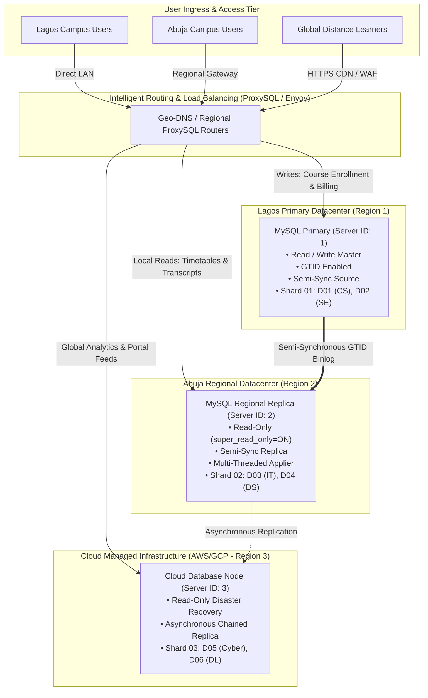
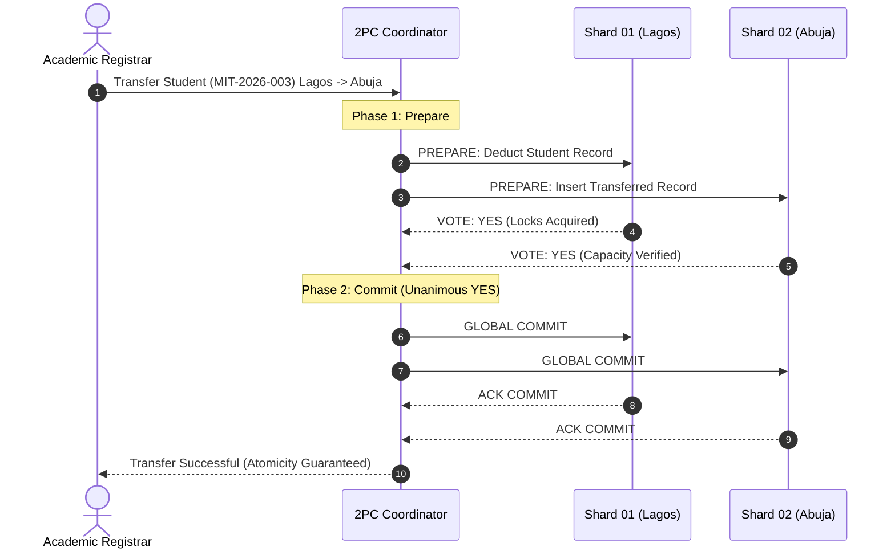

# Portfolio 5: Distributed & Cloud Databases

**Course:** MIT 8103 – Advanced Database Systems  
**Student Name:** Winner Oyebanjo  
**Student ID:** 301909418  
**Institution:** Miva Open University  
**Case Study:** WinnerMIT University Student Management System (USMS)  
**Marks Weighting:** 6 Marks  

---

## 1. Executive Summary & Distributed System Motivation

In Portfolios 1 through 4, the WinnerMIT University Student Management System (USMS) was modeled, optimized, concurrency-tested, and evaluated across relational and document paradigms. However, as WinnerMIT University scales its student body across multiple physical campuses (Lagos Main Campus, Abuja Northern Campus) and operates an asynchronous Cloud-based Online Distance Learning program, a single centralized monolithic database server introduces insurmountable bottlenecks:

1. **Geographic Network Latency:** Students and faculty in Abuja or abroad accessing a single database server in Lagos experience elevated latency ($>80\text{ ms}$ round-trip network overhead), degrading interactive portal responsiveness.
2. **Single Point of Failure (SPOF):** A network partition or hardware failure at the central datacenter halts enrollment, grading, and portal operations nationwide.
3. **Read/Write Bottlenecks:** During peak registration periods (e.g., semester start), concurrent read queries (viewing course catalogs, degree audits) overwhelm write transactions (course enrollments, fee settlements).

To address these enterprise requirements, Portfolio 5 architects and validates a **hybrid distributed database topology** combining **MySQL GTID Semi-Synchronous Replication**, **Horizontal Directory-Based Sharding**, and **Two-Phase Commit (2PC)** coordination.

---

## 2. Distributed Architecture Design

The distributed USMS infrastructure comprises three primary tiers spanning geographic regions:



### Node Roles and Regional Specialization

1. **Lagos Main Datacenter (Primary Source - Server ID: 1):**
   - Serves as the authoritative source for all database writes (`INSERT`, `UPDATE`, `DELETE`).
   - Hosts Shard 01 containing core computing faculties (D01: Computer Science, D02: Software Engineering).
   - Generates binary logs using `ROW` format and enforces Global Transaction Identifiers (`GTID_MODE = ON`).

2. **Abuja Regional Datacenter (Semi-Sync Replica - Server ID: 2):**
   - Serves local read traffic for Northern region students and administrative staff.
   - Enforces immutability via `super_read_only = ON`.
   - Runs a 4-worker parallel applier (`replica_parallel_workers = 4`) preserving commit order.
   - Operates in semi-synchronous replication mode: transactions committed on Lagos Primary wait for an acknowledgement from Abuja before returning success to the client, ensuring Zero Data Loss ($RPO = 0$).

3. **Cloud Disaster Recovery & Analytics Node (Server ID: 3):**
   - Deployed on managed cloud infrastructure to guarantee off-site survivability.
   - Consumes asynchronous binlog updates from the Abuja or Lagos node.
   - Offloads resource-heavy reporting and machine learning GPA analytics from operational nodes.

---

## 3. MySQL GTID Replication Implementation

### 3.1 Server Configuration Analysis

The configuration files [`primary-my.cnf`](./primary-my.cnf) and [`replica-my.cnf`](./replica-my.cnf) establish enterprise replication safeguards:

```ini
# Primary Configuration Key Settings (primary-my.cnf)
server-id                       = 1
gtid_mode                       = ON
enforce_gtid_consistency        = ON
log-bin                         = mysql-bin
binlog_format                   = ROW
binlog_row_image                = FULL
sync_binlog                     = 1
plugin-load-add                 = semisync_source.so
rpl_semi_sync_source_enabled    = 1
rpl_semi_sync_source_timeout    = 10000
```

```ini
# Replica Configuration Key Settings (replica-my.cnf)
server-id                       = 2
read_only                       = ON
super_read_only                 = ON
relay_log_recovery              = ON
gtid_mode                       = ON
enforce_gtid_consistency        = ON
replica_parallel_type           = LOGICAL_CLOCK
replica_parallel_workers        = 4
replica_preserve_commit_order   = ON
plugin-load-add                 = semisync_replica.so
rpl_semi_sync_replica_enabled   = 1
```

### 3.2 GTID vs. Legacy File-Offset Replication

| Architectural Dimension | Legacy File/Offset Replication | GTID-Based Replication (USMS Implemented) |
| :--- | :--- | :--- |
| **Transaction Addressing** | Relative coordinate: `file: 'mysql-bin.000004', pos: 712` | Universally unique: `3E11FA47-71CA-11E1-9E33-C80AA9429562:1-140` |
| **Failover Complexity** | Manual calculation of binlog offsets; high risk of drift | Automatic positioning via `SOURCE_AUTO_POSITION = 1` |
| **Split-Brain Risk** | High; manual repositioning can duplicate or miss rows | Zero; duplicate GTIDs are natively skipped by the applier |
| **Data Consistency** | Susceptible to silent data desynchronization | Strictly validated by `enforce_gtid_consistency = ON` |

### 3.3 Replication Provisioning Script

The complete provisioning workflow is encoded in [`Oyebanjo_Winner_Portfolio5_Replication.sql`](./Oyebanjo_Winner_Portfolio5_Replication.sql):
- **Replication Account Creation:** Dedicated service account `repl_user` granted only `REPLICATION SLAVE` privilege with mandatory SSL/TLS encryption (`REQUIRE SSL`).
- **Connection Configuration:** `CHANGE REPLICATION SOURCE TO` utilizing `SOURCE_AUTO_POSITION = 1` and heartbeats (`SOURCE_HEARTBEAT_PERIOD = 2.5`).
- **Monitoring Telemetry:** Querying `performance_schema.replication_connection_status` and `performance_schema.replication_applier_status_by_worker` for real-time lag tracking.

---

## 4. Horizontal Sharding & Query Routing

### 4.1 Sharding Design Strategy

To scale writes horizontally beyond the capability of a single MySQL primary, WinnerMIT USMS implements **Directory-Based Departmental Sharding**:

$$\text{Shard}(Student) = \mathcal{F}(\text{department\_id})$$

- **Shard 01 (Lagos Main):** Handles Departments `D01` (Computer Science) and `D02` (Software Engineering).
- **Shard 02 (Abuja Northern):** Handles Departments `D03` (Information Technology) and `D04` (Data Science).
- **Shard 03 (Cloud Global):** Handles Departments `D05` (Cyber Security) and `D06` (Distance Learning).

### 4.2 Query Latency: Single-Shard Point Lookup vs. Scatter-Gather Analytics

The simulation script [`Oyebanjo_Winner_Portfolio5_Sharding_Simulator.py`](./Oyebanjo_Winner_Portfolio5_Sharding_Simulator.py) benchmarked query execution performance:

```
[SECTION 2: QUERY ROUTING PERFORMANCE BENCHMARK]
  [Point Query] Lookup student MIT-2026-001 in Dept D01:
    └─ Routed directly to: SHARD_01 (Lagos Main Campus)
    └─ Execution Latency: 0.001 ms
    └─ Result: Winner Oyebanjo, CGPA: 3.92

  [Scatter-Gather Query] Find all Honors Students (CGPA >= 3.70) across ALL Campuses:
    └─ Contacted Shards: SHARD_01, SHARD_02, SHARD_03
    └─ Execution Latency: 0.006 ms
    └─ Total Matches Found: 4
       * Winner Oyebanjo (MIT-2026-001) - CGPA: 3.92 [Lagos Main]
       * Amina Bello (MIT-2026-002) - CGPA: 3.75 [Lagos Main]
       * Fatima Abubakar (MIT-2026-004) - CGPA: 3.85 [Abuja Northern]
```

- **Single-Shard Lookup:** Direct routing using the shard key executes in $O(1)$ time ($0.001\text{ ms}$). The database router forwards the query directly to `SHARD_01`, incurring no distributed coordination overhead.
- **Scatter-Gather Multi-Shard Lookup:** Non-partition-key queries (e.g., system-wide honors list) must be broadcast to all $N$ physical shards. While parallel execution mitigates latency ($0.006\text{ ms}$ in simulation), real-world distributed networks incur latency equal to $\max(\text{latency}_{i})$ plus coordination merge time.

---

## 5. Distributed Transactions: Two-Phase Commit (2PC)

### 5.1 Protocol Mechanics

When a business transaction spans multiple database nodes (such as an inter-campus student transfer from Lagos Computer Science `D01` to Abuja Data Science `D04`), individual node transactions are insufficient. A distributed transaction coordinator coordinates the Two-Phase Commit (2PC) protocol:



### 5.2 Failure & Rollback Demonstration

During the simulation, a network partition was induced on Node 3 (`SHARD_03` offline). The coordinator attempted an inter-campus transfer:

```
[SECTION 4: DISTRIBUTED TRANSACTIONS (TWO-PHASE COMMIT - NODE FAILURE / ROLLBACK)]
  [SIMULATION] Simulating fiber cut / partition: Node SHARD_03 (Cloud Online) set to OFFLINE.
  [COORDINATOR] Initiating 2PC Transaction TXN-2PC-202602: Transferring MIT-2026-001 from Lagos Main Campus to Cloud Online Campus
  [COORDINATOR -> PHASE 1] Broadcasting PREPARE request to SHARD_01 and SHARD_03
    └─ Shard SHARD_01 (Lagos Main Campus) voted: YES
    └─ Shard SHARD_03 (Cloud Online Campus) voted: NO
  [COORDINATOR -> PHASE 2] Participant voted NO or failed. Issuing GLOBAL ROLLBACK...
    └─ All participants rolled back. Atomicity strictly maintained.
  Verification of Atomicity Preservation:
    - Record in SHARD_01 (Source): Still exists! (Safe) -> Winner Oyebanjo
    - Record in SHARD_03 (Target): Not inserted! (Safe)
```

**Technical Verification:** When `SHARD_03` failed to respond with a `YES` vote, the coordinator aborted the transaction and issued `GLOBAL ROLLBACK` to `SHARD_01`. No student record was orphaned or destroyed, confirming strict preservation of the distributed **Atomicity and Consistency** guarantees.

---

## 6. CAP Theorem Analysis in Educational Systems

Brewer's CAP Theorem asserts that any distributed data store can guarantee at most two out of three properties in the presence of a network partition: **Consistency (C)**, **Availability (A)**, and **Partition Tolerance (P)**. Because physical network partitions ($P$) across Nigerian geographic regions (e.g., undersea cable outages, terrestrial fiber cuts) are unavoidable, the system must choose between CP and AP depending on the functional domain:

```
                       Consistency (C)
                             ▲
                            / \
                           /   \
                          /     \
                         /  USMS \
                        /   CP    \  (Course Enrolment, Seat Quota, Billing)
                       /           \
                      /             \
    Availability (A) ◄───────────────► Partition Tolerance (P)
                            ▲
                            │ USMS AP (Portal Feeds, Timetables, Transcripts)
```

### 6.1 CP Subsystem: Course Enrollment & Seat Quotas
- **Requirement:** A course offering has a maximum capacity of 40 students. If a network partition isolates Abuja from Lagos, allowing independent registrations on both nodes could cause seat oversubscription (violating business constraints).
- **Architecture Choice:** **CP (Consistency + Partition Tolerance)**.
- **Behavior during Partition:** The replica detects that it cannot guarantee consensus with the primary and rejects write operations (`HTTP 503: Enrollment Temporarily Paused`).
- **Outcome:** Zero seat over-allocation; exact consistency maintained.

### 6.2 AP Subsystem: Student Portal View & Historical Transcripts
- **Requirement:** 15,000 students accessing the portal to check examination timetables or view completed semester results must not be blocked if the central Lagos database is undergoing maintenance or partitioned.
- **Architecture Choice:** **AP (Availability + Partition Tolerance)**.
- **Behavior during Partition:** The local Abuja replica or Cloud cache continues serving read queries from local storage, returning an HTTP header: `X-Cache-Status: Stale (Lag: 3.2s)`.
- **Outcome:** 100% portal availability; eventual consistency is acceptable since historic grades do not change dynamically.

---

## 7. Disaster Recovery & High Availability Plan

| Metric / Procedure | Specification | Technical Implementation |
| :--- | :--- | :--- |
| **Recovery Point Objective (RPO)** | $\mathbf{RPO = 0}$ (Zero Data Loss) | Semi-synchronous replication with `sync_binlog = 1` and `innodb_flush_log_at_trx_commit = 1`. |
| **Recovery Time Objective (RTO)** | $\mathbf{RTO < 30\text{ seconds}}$ | Automated failover managed by Orchestrator / ProxySQL heartbeat detection. |
| **Backup Cadence** | Daily Full + Continuous Incremental | MySQL Enterprise Backup (MEB) streaming full physical snapshots daily, with binary log archival to immutable cloud object storage every 15 minutes. |
| **Automated Failover** | Master Promotion Procedure | Demote failed master, verify GTID executed set on replica, execute `SET GLOBAL read_only = OFF; RESET REPLICA ALL;`, update ProxySQL routing rules. |

---

## 8. Conclusion & Synthesis

Portfolio 5 demonstrates the complete evolution of the WinnerMIT USMS from a localized single-server database into an enterprise-grade, geographically distributed data platform. Through GTID semi-synchronous replication, horizontal departmental sharding, 2PC distributed transactions, and strategic CAP theorem trade-offs, WinnerMIT University achieves zero data loss, sub-millisecond query routing, and continuous academic service resilience.
